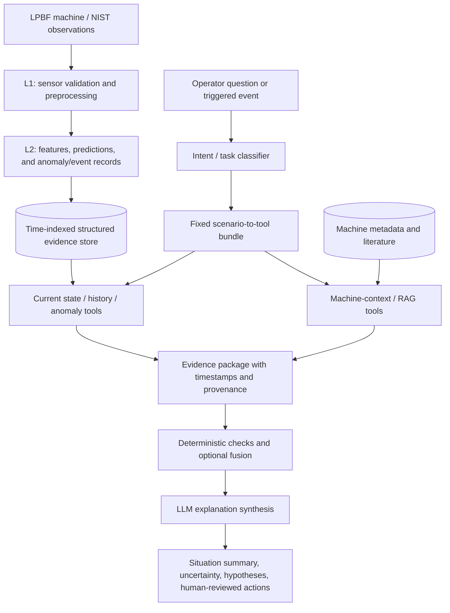

# DIPy-AI: Related Work, Architecture Landscape, and Publication Positioning

**Research note — literature checked 28 October 2026**  
**Domain:** laser powder bed fusion (LPBF/PBF-LB/M), industrial process monitoring, situational awareness, knowledge-grounded LLM agents, neuro-symbolic systems  
**Project:** [DIPy-AI](https://github.com/AndreRab/DIPY-AI)  
**Companion project document:** [`docs/dipy-ai-layer-3-research-and-proposal.md`](./dipy-ai-layer-3-research-and-proposal.md)

> **Scope and evidentiary limits.** This is a publication-planning literature review, not a formal systematic review. Architecture descriptions below are grounded in publisher abstracts, accessible article text, or preprints (identified as such). A paper's omission of a feature from its abstract is **not** proof that the feature is absent from its full implementation. Before submission, inspect the full texts, figures, experimental protocols, and references of the closest competitors. Proposed DIPy-AI components and evaluation results must not be represented as implemented or validated until verified in the repository and experiments.

## 1. Executive assessment

The research gap **cannot** be stated as simply “using an LLM, RAG, and tools to interpret additive-manufacturing data.” By 2026 there are published systems combining industrial telemetry with LLM agents, LPBF-specific multimodal RAG, graph-assisted defect reasoning, semantic digital twins, and hybrid data-driven/knowledge-driven predictions.

The most consequential comparisons are:

1. **AM-Agent** [R1] already integrates LPBF prediction models, RAG, digital-twin context, LLM-orchestrated services, and explicit confidence-based fusion. Its target is principally **part-specific pre-build quality planning** rather than event-driven situational understanding during a build.
2. **Towards Agentic Defect Reasoning** [R2] already uses a knowledge graph, vector retrieval, and an agent to produce interpretable LPBF parameter–mechanism–defect paths. It primarily reasons over **scientific literature**, not a synchronized live machine state.
3. **Interactive Multimodal Quality Assessment** [R3] already transforms heterogeneous LPBF measurements and images into semantically usable representations, queried via a vision-language model. Its evidence is centered on **multimodal quality exploration** rather than causally qualified, time-windowed telemetry-event interpretation.
4. **ChatCNC** [R5], **Gautam et al.** [R6], and **Erfani Jazi & Ameri** [R7] already demonstrate combinations of **real-time/historical machine data, specialist agents, semantic contexts, and RAG** in manufacturing. They make generic “industrial copilot” novelty claims weak.
5. **Hong et al.** [R8] place ontology reasoning inside a LPBF **control loop**, while DIPy-AI aims at **operator-facing, human-reviewed decision support**, not machine actuation.
6. **Hong, Lu & Cho** [R9] show why physically meaningful labels, deployment-oriented splits, timing constraints, and traceable verification matter. Their work is important for experimental methodology even though their target is not an LLM reasoning assistant.

**Recommended publication hypothesis:** A **controlled, temporally grounded, evidence-provenance-aware reasoning layer** operating over standardized LPBF event streams can improve *situation comprehension, consistency, traceability, and robustness* compared with raw-data prompting, conventional RAG, and unrestricted tool-calling, **without** claiming autonomous control or physically validated causal inference. This is a **hypothesis requiring experiments**, not an established novelty claim.

## 2. Reference DIPy-AI architecture and boundaries

The repository describes a three-layer pipeline:

- **L1 — Sensor layer:** validation, calibration, and sensor-specific preprocessing.
- **L2 — Information / ML layer:** structured derived observations, model predictions, and anomaly information.
- **L3 — Knowledge and reasoning layer:** a controlled LLM workflow that selects a predefined tool bundle, collects structured evidence, and produces an operator-facing interpretation.

The existing architecture proposal specifies use-case-specific bundles for `current_state`, `history`, `anomaly_context`, `machine_context`, and `RAG`; `forecast_model` and deterministic `evidence_fusion` are candidate extensions. Implementation details (e.g., LangGraph orchestration) should be stated as implemented only if confirmed against the current source code.

The key operational constraint is **no direct autonomous actuation**. For datasets replayed offline, describe the system as *time-indexed simulation/replay* or *near-real-time-capable architecture* **only if latency is measured**; do not call it experimentally validated real-time monitoring without actual streaming and latency evidence.

### 2.1 What “symbolic” does and does not mean

- A JSON record such as `{ "time": ..., "event": "melt_pool_intensity_high" }` is **structured data / symbolic event representation**.
- It becomes **formal symbolic reasoning** only when the system executes explicit relations, constraints, rules, graph traversal, logic entailment, temporal logic, etc.
- An LLM verbally interpreting structured events does **not by itself** justify describing the system as formally *neuro-symbolic*.
- Similarly, ranking possible explanations from correlated signals is **hypothesis generation**, not proof of physical causality. Distinguish known mechanism, model association, and unverified hypothesis.

This distinction matters because [R7], [R8], and [R10] use ontologies, knowledge graphs, or logical reasoners in stronger, explicitly defined senses.

## 3. Architecture taxonomy

### A. Prediction + knowledge fusion

**Pattern:** process features → material/process-specific ML models → defect/quality probabilities; in parallel, RAG and digital-twin context → knowledge-derived prediction; reliability-aware fusion → result.  
**Primary exemplar:** AM-Agent [R1].  
**DIPy-AI implication:** keep probability calculation and evidence fusion outside the natural-language synthesis model. If fusion becomes a core scientific contribution, compare calibrated fusion against naive averaging, confidence-only rules, and LLM-only reconciliation.

### B. Evidence-graph defect reasoning

**Pattern:** papers/manuals → extracted entities and causal or mechanistic associations → knowledge graph + semantic index → graph/vector retrieval → agent-generated defect explanation.  
**Primary exemplars:** Awan et al. [R2], Hasan et al. [R10].  
**DIPy-AI implication:** distinguish *literature-grounded possible failure mechanisms* from *machine-specific evidence*. Attach provenance and confidence to both; do not automatically elevate a retrieved association to an observed cause.

### C. Multimodal LPBF anomaly interpretation

**Pattern:** images/measurements/geometry → domain-specific preprocessing, segmentation and registration → structured representations or cross-modal retrieval → vision-language/LLM inference → interactive query response or classification.  
**Primary exemplars:** Giri et al. [R3], Khanghah et al. [R4].  
**DIPy-AI implication:** domain-specific preprocessing is an established idea. Demonstrate the *additional* contribution of temporal context, scenario routing, cross-event reasoning, calibrated evidence, or robustness to missing/conflicting signals.

### D. Conversational machine monitoring and cognitive twins

**Pattern:** live/historical IIoT records → database/digital-twin/ontology → supervisor or specialized LLM agents / RAG → diagnostics, visualization, or advice.  
**Primary exemplars:** ChatCNC [R5], Gautam et al. [R6], Erfani Jazi & Ameri [R7], Williams et al. [R13], self-evolving twins [R12].  
**DIPy-AI implication:** the mere ability to ask natural-language questions about machinery is already demonstrated. Compare the **controlled workflow** against these more generic architectures on reliability, temporal correctness, operator usefulness, cost, and latency.

### E. Formal neuro-symbolic monitoring/control and deployment assurance

**Pattern:** sensors → estimates → ontology/rules/constraints → controller or verified monitoring pathway.  
**Primary exemplars:** Hong et al. [R8], Hong, Lu & Cho [R9].  
**DIPy-AI implication:** operator support is not control; however, uncertainty, physical observability, labels, and bounded response time still matter. Use separate safety claims and a human-in-the-loop protocol.

## 4. Detailed review of the most relevant works

### [R1] Li et al. (2026) — AM-Agent: data-driven meets knowledge-driven

**Reference:** Jianzhang Li, Dachuan Shi, Zhidong Zhang, and Thomas Bauernhansl. “Data-Driven Meets Knowledge-Driven: An LLM-Agent Framework for Quality Control in Metal Additive Manufacturing.” *Journal of Industrial Information Integration* (2026), article 101182. DOI: https://doi.org/10.1016/j.jii.2026.101182. [Code](https://github.com/quickhdsdc/AMAgent).

**Pipeline:** material/process parameters → **Data-driven Prediction Service** (melt-pool regressors and material-specific defect classifiers) + **Knowledge Service** (RAG over process literature and Asset Administration Shell digital-twin context) → LLM-coordinated retrieval → reliability-weighted **Linear Opinion Pool** for competing predictions.

**Evidence reported:** in-domain and cross-material out-of-domain evaluation; robustness of macro-F1 under distribution shift; conflict analysis of ML predictions and literature-grounded evidence. Exact comparative magnitudes require examination of full tables.

**Overlap:** LPBF, ML + knowledge, LLM orchestration, RAG, machine context, uncertainty-aware integration. **Difference to investigate:** focus on *pre-build process planning*, rather than *continuously evolving, time-indexed, operator-facing situational awareness*. **Reviewer risk: very high.** Any assertion that combining ML, RAG and an LLM is novel would be invalidated by this paper.

### [R2] Awan et al. (2026) — graph-assisted agentic defect reasoning

**Reference:** Muhammad Rizwan Awan et al. “Towards Agentic Defect Reasoning: A Graph-Assisted Retrieval Framework for Laser Powder Bed Fusion.” *arXiv preprint* arXiv:2604.04208 (2026). https://arxiv.org/abs/2604.04208.

**Pipeline:** published LPBF studies → extract parameters, mechanisms and defects → evidence-linked knowledge graph → semantic and graph retrieval → lightweight agent → interpretable explanatory paths. Ti6Al4V is used as the case study.

**Evidence reported:** retrieval accuracy and recall of **0.9667** each, as stated in the abstract. This is retrieval evidence, **not** validation of machine-specific root causes.

**Overlap:** explainable LPBF defect reasoning, scientific evidence, agent-driven retrieval. **Difference to investigate:** static literature-derived evidence graph vs **time-synchronized process-state + event-history** reasoning. **Reviewer risk: very high** for any generic claim about agentic LPBF root-cause reasoning.

### [R3] Giri et al. (2026) — interactive multimodal LPBF quality assessment

**Reference:** Sandesh Giri, Qiaojie Zheng, Xiaoli Zhang, and Sen Liu. “Interactive multimodal quality assessment in laser powder bed fusion using vision-large language models.” *Journal of Manufacturing Processes* 174 (2026), 1168–1181. DOI: https://doi.org/10.1016/j.jmapro.2026.08.008.

**Pipeline:** ORNL Peregrine layer images + spatial registration + defect segmentation + 3D geometry / measured property context → domain preprocessing and semantic data compression → **Llama 3.2-Vision 11B** → natural-language exploration, defect maps, and 3D visualizations.

**Evidence reported:** **39 parts**, over **3,500 layers**, **95% query-interpretation accuracy** across six categories; an ablation reports improvement from **20% to 95% query success** when domain preprocessing is used. Query interpretation is not physical defect-classification accuracy.

**Overlap:** LPBF domain-aware data abstraction, operator queries, multimodal evidence. **Difference to investigate:** temporal event chains, evidence triangulation and explicit decision-support boundaries. **Reviewer risk: very high** for “LLM access to preprocessed LPBF observations” as a novelty claim.

### [R4] Khanghah et al. (2026) — zero-shot multimodal RAG for LPBF anomalies

**Reference:** Kiarash Naghavi Khanghah et al. “Zero-Shot Anomaly Detection in Laser Powder Bed Fusion Using Multimodal Retrieval-Augmented Generation and Large Language Models.” *Journal of Mechanical Design* 148(7) (2026), 072001; online 26 December 2025. DOI: https://doi.org/10.1115/1.4070585; [preprint](https://arxiv.org/abs/2505.13828).

**Pipeline:** process/anomaly images + images and textual descriptions retrieved from scientific literature → multimodal RAG → vision-language model → anomaly classification and explanation.

**Evidence reported:** evaluation on **four ORNL LPBF datasets**; a roughly **12% average accuracy improvement with retrieval** is reported in the paper's abstract/preprint comparison.

**Overlap:** LPBF anomaly analysis grounded in retrieved studies. **Difference:** literature-and-image retrieval rather than a controlled query over machine event chronology. **Reviewer risk: high.**

### [R5] Lee et al. (2025) — ChatCNC

**Reference:** Sang Won Lee et al. “ChatCNC: Conversational machine monitoring via large language model and real-time data retrieval augmented generation.” *Journal of Manufacturing Systems* 79 (2025), 504–514. DOI: https://doi.org/10.1016/j.jmsy.2025.01.018.

**Pipeline:** CNC IIoT machine database → real-time RAG + collaborating LLM agents → context-aware operator responses; prompt/model combinations and agent interaction failure modes are evaluated.

**Evidence reported:** **93.3% accuracy** on complex production-tracking queries (as reported in the abstract). The metric belongs to its own benchmark and is not directly comparable to LPBF anomaly detection.

**Overlap:** conversational monitoring, retrieval of live machine state, multiple agent roles. **Difference:** CNC rather than LPBF; DIPy-AI should establish whether **deterministic tool bundles + provenance** improve reliability over a comparable unrestricted agent setup. **Reviewer risk: high.**

### [R6] Gautam et al. (2025) — IIoT digital twin with LLM agents

**Reference:** Anuj Gautam et al. “IIoT-enabled digital twin for legacy and smart factory machines with LLM integration.” *Journal of Manufacturing Systems* 80 (2025), 511–523. DOI: https://doi.org/10.1016/j.jmsy.2025.03.022.

**Pipeline:** machine data and environmental observations → **MTConnect/IIoT platform** and digital twin → **supervisor, machine-expertise, visualization, fault-diagnosis** agents → contextual interpretations and an operator interface.

**Overlap:** current and historical machine context, supervisory routing, specialist agents, human-facing explanations. **Difference:** heterogeneous machine digital twins and interactive expertise vs an LPBF event/evidence contract with controlled dispatch. **Reviewer risk: high.**

### [R7] Erfani Jazi & Ameri (2026) — LLM-augmented semantic digital twins

**Reference:** Aseman Erfani Jazi and Farhad Ameri. “Large Language Model-Augmented Semantic Digital Twins for Real-Time Fault Diagnosis and Closed-Loop Control.” *Journal of Computing and Information Science in Engineering* 26(9) (2026), 091005. DOI: https://doi.org/10.1115/1.4071805.

**Pipeline:** simulated machine-cell data → semantic mapping into an **ontology / knowledge graph** with **SWRL rules** → targeted RAG → LLM-generated explanation or machine-actionable command.

**Overlap:** semantics, operational context, domain-grounded explanation, fault diagnosis. **Difference:** a formal ontology and potential machine-action commands; DIPy-AI prioritizes read-only, operator-mediated event-based support. **Reviewer risk: very high** if DIPy-AI is labeled “neuro-symbolic” without explicit logic or rules.

### [R8] Hong, Cho & Cho (2026) — ontology-enabled LPBF control

**Reference:** Gisuk Hong, Jaebong Cho, and Hyunbo Cho. “Ontology-enabled neuro-symbolic closed-loop control of laser powder bed fusion.” *Journal of Intelligent Manufacturing* (published 26 October 2026). DOI: https://doi.org/10.1007/s10845-026-03006-y.

**Pipeline:** geometry and melt-pool feedback → neural estimation of an unobserved depth/width relation and uncertainty → ontology + **description-logic reasoner** chooses active process constraints → constraint-aware **model predictive controller** updates laser-power commands.

**Evidence/limits:** numerical case study with a calibrated Eagar–Tsai surrogate; ablations and robustness scenarios. **No physical LPBF experiments** were performed for this study; defect outcomes were computed in simulation.

**Overlap:** LPBF, physical process context, explicit symbolic logic, interpretable constraints. **Difference:** **closed-loop actuation** rather than operator situation awareness. **Reviewer risk: medium for direct functionality, high for terminology.**

### [R9] Hong, Lu & Cho (2026) — standards-based LPBF monitoring engineering

**Reference:** Gisuk Hong, Yan Lu, and Hyunbo Cho. “A standards-based systems engineering framework for AI-enabled in-situ monitoring in laser powder bed fusion.” *International Journal of Advanced Manufacturing Technology* (4 September 2026). DOI: https://doi.org/10.1007/s00170-026-19015-3.

**Pipeline:** define monitoring objective and physical mechanism → requirements and label taxonomy → data representativeness and annotation uncertainty → deployment-oriented split, model, latency budget and verification; the framework references ISO/IEC 25059, ISO/IEC 5259-4, ASTM E3353 and ISO/IEC 5338.

**Evidence/limits:** shows that binary labeling can obscure opposing keyhole vs lack-of-fusion corrective actions, while mixed scan-pattern splitting obscures distribution shift. The case study lacks direct volumetric defect ground truth and identifies robustness limitations.

**Relevance:** use as a **methodological anchor** for label validity, data leakage, physically qualified interpretation, design requirements and traceability. **Reviewer risk: medium/high** for claims of methodologically rigorous monitoring without conforming evidence.

### [R10] Hasan et al. (2023) — LPBF process-defect ontology

**Reference:** Nazmul Hasan et al. “Process Defects Knowledge Modeling in Laser Powder Bed Fusion Additive Manufacturing: An Ontological Framework.” *Manufacturing Letters* 35 Suppl. (2023), 822–833. DOI: https://doi.org/10.1016/j.mfglet.2023.08.132.

**Pipeline:** systematic defect and causal-factor taxonomy → OWL/RDF ontology → graph queries, ontology reasoning, SPARQL, causal-link exploration.

**Evidence reported:** ontology represents **31 defect types** and **45 causal factors**, as reported in the abstract.

**Overlap:** structured LPBF defect knowledge and possible cause–effect relations. **Difference:** formal knowledge representation rather than LLM inference over recent machine events. **Relevance:** an excellent source for domain taxonomy and **guardrails for root-cause explanations**.

### [R11] Halder & Mojumder (2026) — agentic in-situ monitoring for WAAM

**Reference:** Pallock Halder and Satyajit Mojumder. “In-situ process monitoring for defect detection in wire-arc additive manufacturing: an agentic AI approach.” *arXiv preprint* arXiv:2604.09889 (2026). https://arxiv.org/abs/2604.09889.

**Pipeline:** current/voltage and acoustic streams → independently trained defect classifiers → **processing and monitoring agents** → multi-agent orchestration and defect decision; classifiers use XCT-based ground truth.

**Evidence reported:** **91.6% decision accuracy**, **F1 0.821**, on decided runs across **15 independent runs**; these values are specific to the paper's setting.

**Overlap:** industrial signals, ML tools, agent coordination, additive manufacturing. **Difference:** WAAM, sensor-classification orchestration and multi-agent decisions rather than LPBF knowledge retrieval + temporal situation explanation. **Reviewer risk: medium/high.**

### [R12] Self-evolving digital twins (2026)

**Reference:** Ding Gao, Xiaojian Wen, Jianhao Lv, Jiahui Si, Cong Wang, and Jinsong Bao. “Self-evolving digital twins in flexible manufacturing: A large language model-powered multi-agent approach.” *Digital Engineering* 10 (2026), 100099. DOI: https://doi.org/10.1016/j.dte.2026.100099.

**Pipeline:** heterogeneous production data → LLM **Graph Agent** builds/updates a knowledge graph → hierarchical agent collaboration coordinates knowledge, behavior and geometry components of a production-line digital twin → adaptive reconfiguration.

**Evidence reported:** simulated defect monitoring/sorting-line experiments and reduction in changeover/recovery time reported by the authors. The application and operational goals differ from LPBF.

**Overlap:** LLM + evolving structured process context + factory situation awareness. **Difference:** self-modifying digital-twin operation and production-line adaptation vs an auditable, bounded, read-only LPBF assistant. **Reviewer risk: medium.**

### [R13] Williams et al. (2026) — cross-domain predictive-maintenance twin

**Reference:** John Williams et al. “Cross-domain digital twin architecture for predictive maintenance via machine learning and Large Language Models.” *Computers & Industrial Engineering* 215 (2026), 111914. DOI: https://doi.org/10.1016/j.cie.2026.111914; [supporting dataset](https://github.com/UTK-ASL/Dataset_digital_twin_predictive_maintenance).

**Pipeline:** sensors → MQTT → Random Forest fault classifier → edge LLM → concise maintenance guidance delivered to AR/web operators, with a game-engine digital twin.

**Overlap:** L1/L2/L3 progression from sensor observation to actionable text. **Difference:** maintenance guidance after fault classification, without the proposed multi-source LPBF temporal-evidence reasoning. **Reviewer risk: medium.**

### [R14] Endsley (1995) — situation awareness as a target construct

**Reference:** Mica R. Endsley. “Toward a Theory of Situation Awareness in Dynamic Systems.” *Human Factors* 37(1) (1995), 32–64. DOI: https://doi.org/10.1518/001872095779049543.

**Theory:** perception of relevant elements, comprehension of their meaning, and projection of likely future status are separate aspects of situation awareness.

**DIPy-AI implication:** assess the system on **current-state reporting**, **cross-signal interpretation**, and **qualified future implications**, separately. A fluent natural-language summary is not proof of situational awareness.

### [R15] Yang et al. / NIST (2025) — registered AMMT dataset

**Reference:** Zhuo Yang, Yan Lu, Ho Yeung, Brandon Lane, and Nicole Van Handel. “A Fully Registered In-Situ and Ex-Situ Dataset for Metal Powder Bed Fusion Additive Manufacturing: Data Processing, Feature Extraction, Registration, and Uncertainties.” *NIST Advanced Manufacturing Series* 100-69 (2025). DOI: https://doi.org/10.6028/NIST.AMS.100-69; [NIST record](https://www.nist.gov/publications/fully-registered-situ-and-ex-situ-dataset-metal-powder-bed-fusion-additive).

**Relevance:** describes alignment of AMMT **Overhang Part X4** process-monitoring observations and ex-situ XCT data for four overhang parts, including uncertainties. Registered fields include laser power, process parameters, melt-pool measurements and layer-wise optical information.

**DIPy-AI implication:** explicitly document alignment, granularity, event derivation, uncertainties, train/test separation, and the extent of available ground truth. Registration is not the same as causal validation of each L2 event.

## 5. Cross-paper architecture comparison

**Legend:** ✓ central reported feature; ~ related/partial feature; — not established as a central feature in the sources reviewed. “—” is **not** a formal proof of absence. Scope labels are descriptive, not quality rankings.

| Work | Process / primary data | Semantic / structured representation | Agent/tool orchestration | Time-indexed machine state | Main output | Primary validation |
|---|---|---|---|---|---|---|
| **DIPy-AI (proposed)** | LPBF derived sensor events | L2 events + evidence schema | Fixed scenario bundles (L3) | **Target capability** | Situation + grounded guidance | **Not yet established** |
| [R1] AM-Agent | LPBF parameters/predictions | AAS context, RAG | LLM-driven services + deterministic fusion | ~ Pre-build machine/material context | Defect-quality prediction | In/OOD classification and fusion |
| [R2] Awan et al. | LPBF research literature | Evidence KG + embeddings | Lightweight retrieval agent | — | Mechanism / defect paths | Retrieval accuracy/recall |
| [R3] Giri et al. | LPBF images, 3D data | Registered/semantically compressed data | V-LLM querying | ~ Layer/spatial indexing | Interactive quality explanation | Query interpretation and ablations |
| [R4] Khanghah et al. | LPBF image evidence | Text/image RAG | Multimodal inference | — | Anomaly class/explanation | Four ORNL datasets |
| [R5] ChatCNC | CNC IIoT database | Retrieved machine records | Multi-agent LLM + RAG | ✓ | Conversational status/tracking | Question accuracy / failure modes |
| [R6] Gautam et al. | Heterogeneous IIoT machines | Digital twin | Supervisor + specialist agents | ✓ | Machine diagnosis / visualization | Prototype case study |
| [R7] Erfani Jazi & Ameri | Simulated machine-cell data | Ontology + KG + SWRL | RAG + LLM | ✓ contextual simulated stream | Explanation / machine command | Simulated use cases |
| [R8] Hong et al. control | LPBF melt-pool/geometry | Ontology + description logic | Symbolic constraint selection + MPC | ✓ control-loop state | Laser-power command | Numerical case study / ablations |
| [R9] Hong et al. assurance | LPBF monitoring images | Label and requirement taxonomy | Systems-engineering workflow | ~ latency/monitoring scale | Qualified monitoring design | Paired design experiments |
| [R10] Hasan et al. | LPBF literature | OWL/RDF causal ontology | Ontology/SPARQL reasoning | — | Defect/causal-factor knowledge | Ontology competency queries |
| [R11] Halder & Mojumder | WAAM current/voltage/audio | Classifier decisions | Multiple sensor-specialist agents | ~ in-situ signals | Defect classification | XCT-labeled runs |
| [R12] Self-evolving twins | Flexible production line | Dynamic knowledge graph | LLM multi-agent coordination | ✓ production-line state | Adaptive twin behavior | Sorting-line simulation |
| [R13] Williams et al. | Industrial machine telemetry | Predicted fault state | ML → edge LLM | ✓ monitored sensor states | Maintenance guidance | Two testbeds |

### 5.1 The most important overlaps to acknowledge explicitly

- **Industrial LLM access to real-time data is not new:** [R5], [R6], [R7].
- **LPBF-specific LLM explanation and RAG are not new:** [R1], [R2], [R3], [R4].
- **Converting multimodal LPBF data into manageable representations is not new:** [R3], [R15].
- **An ontology for LPBF defects is not new:** [R10]; logic integrated into LPBF control is demonstrated in simulation by [R8].
- **ML specialist tools orchestrated by agents are not new:** [R1], [R6], [R11].
- **Evidence/calibration-aware integration is not automatically novel:** [R1] explicitly provides a fusion approach.

## 6. Candidate scientific contribution: formulate narrowly and test it

### Contribution C1 — temporal evidence contract (strong candidate)

Define a reproducible machine-state/event interface that expresses **what was observed, when, on which part/layer/scan, by which sensor or model, with what quality/uncertainty and provenance**. It should support windows, ordering, changes from baseline, and contradictions.

**Potential hypothesis H1:** with matched underlying information, the structured time-indexed evidence interface improves temporal factual accuracy and reduces unsupported assertions relative to raw telemetry in prompts and timestamp-agnostic RAG.  
**Required proof:** comparative benchmark and evidence-trace audit; mere implementation is insufficient.

### Contribution C2 — bounded scenario-based evidence acquisition (strong candidate)

A classifier maps operator queries or L2 events to **predeclared** read-only tool bundles. Execute bounded calls (potentially in parallel), validate returns, and synthesize only after constructing a typed evidence package.

**Potential hypothesis H2:** bounded routing achieves a more favorable *accuracy / latency / cost / tool-failure* trade-off than a free-form ReAct-like agent and a static one-size-fits-all retrieval bundle.  
**Required proof:** matched model, prompts, tool information and tokens where possible; report accuracy plus p50/p95 latencies, calls and failures.

### Contribution C3 — calibrated cross-source interpretation (conditional candidate)

Separate **observed measurements**, **L2 model outputs**, **retrieved domain knowledge**, and **LLM-generated hypotheses**. Require traceable support, identify conflicts, decline to rank a root cause when evidence is insufficient, and do not let the LLM silently calculate numeric probabilities.

**Potential hypothesis H3:** provenance-aware evidence validation lowers contradiction and false-causality rates and improves abstention calibration over ordinary RAG.  
**Caution:** compare against AM-Agent [R1] and formal semantic approaches [R7]/[R10]; there is no novelty in simply adding source citations.

### Contribution C4 — formal semantics / neuro-symbolic inference (only if actually implemented)

If a schema is linked to executable temporal/causal constraints, such as rules describing alert persistence, context-dependent exclusions, mutually incompatible physical states, or domain-qualified causal paths, evaluate the rules separately. Without explicit formal reasoning, call the system **structured-evidence-grounded**, not “formal neuro-symbolic reasoning.”

### Possible defensible manuscript claim

> We investigate a controlled, evidence-grounded architecture for interpreting time-indexed LPBF monitoring events. The approach separates task routing, source-specific retrieval, machine-state reconstruction, rule-based validation (where present), and language-model synthesis. We evaluate whether this decomposition improves temporal consistency, evidential traceability, and operator-oriented situation assessment relative to less constrained LLM baselines under realistic missing-data and distribution-shift conditions.

This is deliberately a **research question and method statement**, not a statement of achieved superiority.

## 7. Recommended evaluation design

### 7.1 Tasks, ground truth and annotation

Construct a test set of question/event episodes whose reference answers are established **before** seeing model responses. Include:

1. **Level 1 / perception:** current state, machine parameters, active alarms, layer or scan identity.
2. **Level 2 / comprehension:** anomalous change relative to baseline, cross-sensor agreement, sequence reconstruction and physically supported interpretation.
3. **Level 3 / projection:** clearly labeled risk implications and conditional forecasts **only where validated forecast labels or models exist**.
4. **Evidence and uncertainty:** insufficient information, contradictory events, stale data, missing sensor, ambiguous unit or timestamp.
5. **Safety/operator usefulness:** distinguish “verify/check” advice from executable machine commands; expert-grade actionability and appropriate uncertainty.

Use domain-expert annotation with a rubric: *directly observed*, *supported interpretation*, *plausible but unconfirmed*, *unsupported*. For any root-cause task, explicitly state whether a measured ex-situ defect, causal intervention, or only a proxy is available.

### 7.2 Baselines

| Baseline | What it isolates |
|---|---|
| **B0:** deterministic rules + templated answers, no LLM | Value of natural-language synthesis beyond straightforward facts |
| **B1:** raw telemetry/events pasted into the LLM | Value of structure and curated evidence |
| **B2:** conventional text RAG + LLM, no dynamic machine tools | Value of machine-state grounding |
| **B3:** unrestricted LLM tool-calling agent over the **same tools** | Value of bounded tool selection |
| **B4:** fixed tool bundle for all queries + LLM | Value of task-aware routing rather than merely using tools |
| **B5:** proposed complete controlled system | Joint effect |
| **B6 (if fusion):** weighted vs naive vs LLM-only fusion | Contribution of calibrated cross-source fusion |

**Fairness constraint:** do not intentionally starve baselines of information that the proposed method receives. Compare on the same event history, retrieval corpus, observation timestamps, and model family where possible. Log tokens and retrieval budget.

### 7.3 Ablation study

| Ablation | Experimental question |
|---|---|
| Remove history tool | Does temporal reasoning genuinely require historical evidence? |
| Remove machine context | Does machine/material context prevent generic explanations? |
| Remove anomaly context | Does a separate L2 anomaly signal add utility over raw state? |
| Remove RAG | Does external knowledge improve domain interpretation? |
| Replace predefined bundles with free-form routing | Does deterministic orchestration reduce variability and tool misuse? |
| Remove timestamps/provenance | Does evidence metadata prevent stale or misattributed claims? |
| Remove conflict/abstention check | Does validation reduce unsupported definitive conclusions? |
| Replace structured events with unstructured logs | Is symbolic/typed normalization necessary? |

Prioritize a small, coherent factorial design; not every combination needs to be evaluated if it has no scientific interpretation.

### 7.4 Metrics and reporting

- **Factual state accuracy:** exact match or field-level precision/recall for observed facts and times.
- **Temporal correctness:** order-of-events, reference-window and freshness accuracy.
- **Evidence grounding:** citation/source precision, supported-claim rate, unsupported-claim rate, retrieved-evidence relevance.
- **Mechanistic correctness:** expert-scored distinction between observation, association and plausible mechanism.
- **Safety and uncertainty:** inappropriate-command rate, correct abstention rate, selective accuracy at coverage levels, confidence calibration if scores are supplied.
- **Efficiency:** p50/p95 response time, LLM tokens/cost, tool calls, unsuccessful calls.
- **Repeatability:** variation across repeated inference seeds, prompts, model versions, and test episodes.
- **Generalization:** performance on held-out parts/builds, parameter regimes, materials or machine configurations **where available**.

Report confidence intervals or bootstrap uncertainty at the **independent build/part/episode** level, not only at sample-window level. Check independence: neighboring scan windows and adjacent layers can be highly correlated.

### 7.5 Data and leakage controls

For NIST AMMT X4 [R15], write down the unit of observation and the grouping key explicitly: build, part, scan track, layer, time window and sensor channel. If multiple windows belong to one part/build, random splitting of windows can create near-duplicates across train and test. Prefer group-aware or chronology-aware splits; report what each split can and cannot establish. With only four overhang parts in the registered dataset, strong cross-part generalization claims may be statistically limited. Keep evidence retrieval test references distinct from any benchmark answers that would leak the desired conclusion.

Where L2 alarms are **synthetically generated**, report them separately from physical observations and real XCT-labeled outcomes. Synthetic event reasoning can validate software/LLM behavior, but it cannot independently establish LPBF physical diagnostic accuracy.

### 7.6 Minimal publishable experiment set

An achievable first study would include: (i) a frozen LPBF replay dataset and a documented L2 event schema; (ii) 50–150 expert-reviewed, episode-level questions across the task categories above, with uncertainty reported and an explicit sampling rationale; (iii) B1–B5 on identical input episodes; (iv) ablations for history, provenance and routing; (v) timestamp-shift, missing-sensor and contradictory-evidence stress tests; and (vi) latency/cost/repeatability measurements. The question count is a suggested planning range, not a guarantee of statistical power. Calculate sample requirements from the intended effect size and independence unit.

## 8. Suggested publication narrative

**Problem:** sensor-rich LPBF monitoring still requires engineering expertise to connect observed events across time to domain-qualified interpretations without overclaiming defect causation.

**Gap:** existing work demonstrates multimodal LPBF QA [R3], image/literature RAG [R4], paper-based defect KG reasoning [R2], pre-build prediction/knowledge fusion [R1], and live-data industrial copilots [R5–R7], but a *controlled, rigorously evaluated* operator-facing design centered on **typed, time-indexed LPBF event evidence, provenance, constrained tool access, and uncertainty-safe situation interpretation** remains a testable direction. This is a **targeted gap claim for further full-text verification**, not an exhaustive assertion of absence.

**Method:** L1/L2/L3 separation, reproducible event contract, bounded tool bundles, validated evidence package, conservative synthesis, human review.

**Research questions:**

- **RQ1:** Does typed, time-aligned evidence improve LPBF situation comprehension relative to raw prompt input and ordinary RAG?
- **RQ2:** Does deterministic scenario routing improve reliability and efficiency relative to unrestricted tool calling?
- **RQ3:** Do explicit provenance, uncertainty checks, and abstention reduce unsupported diagnosis under contradictory or incomplete observations?
- **RQ4 (optional):** Does formal domain reasoning improve consistency beyond structured retrieval alone?

**Article outline:** (1) Introduction and problem definition; (2) situational-awareness construct and related architectures; (3) evidence representation and L3 architecture; (4) experimental protocol and baselines; (5) results and ablations; (6) threats to validity; (7) conclusions.

## 9. Non-negotiable limitations to disclose

- **Offline vs online:** a replayed stream is not a demonstrated production-real-time deployment.
- **Correlation vs causation:** observational anomalies do not uniquely identify root causes; XCT and process-label observability constraints matter [R9], [R15].
- **Model-generated text is not a physics oracle:** retrieval and expert review help, but do not eliminate hallucination.
- **Dataset scale/domain:** one benchmark and a few parts cannot substantiate generalization across machines, powders or factories.
- **Agent orchestration alone is weak novelty:** compare with [R1], [R5–R7], [R11].
- **No uncontrolled actuation:** operator-facing guidance must remain separate from verified industrial control.
- **Literature status:** [R2] and [R11] are preprints in the sources checked; do not list them as peer-reviewed journal articles without independent verification.

## 10. Prioritized reading plan

**Priority A — review full text and diagrams before locking the novelty statement:** [R1] AM-Agent; [R2] agentic LPBF defect reasoning; [R3] Giri V-LLM; [R7] semantic digital twins; [R5] ChatCNC.

**Priority B — shape the experiment and terminology:** [R9] standards-based LPBF monitoring; [R10] LPBF ontology; [R8] neuro-symbolic control; [R15] NIST dataset.

**Priority C — position industrial transferability and alternatives:** [R4] multimodal RAG; [R6] IIoT digital twin; [R11] WAAM agentic monitoring; [R12] self-evolving twins; [R13] predictive-maintenance twin; [R14] Endsley situational-awareness theory.

**Next research deliverable:** build a **claim–prior-art–experiment matrix**. For each proposed contribution, identify the closest paper, the exact non-overlapping feature, the null hypothesis, baseline, dataset and metric. Do not write the paper's novelty paragraph until at least the Priority A full texts and architectures have been checked.

---

## References and persistent links

- **[R1]** Li, J., Shi, D., Zhang, Z., & Bauernhansl, T. (2026). *Data-Driven Meets Knowledge-Driven: An LLM-Agent Framework for Quality Control in Metal Additive Manufacturing.* Journal of Industrial Information Integration, 101182. https://doi.org/10.1016/j.jii.2026.101182
- **[R2]** Awan, M. R., et al. (2026). *Towards Agentic Defect Reasoning: A Graph-Assisted Retrieval Framework for Laser Powder Bed Fusion.* arXiv:2604.04208 (preprint). https://arxiv.org/abs/2604.04208
- **[R3]** Giri, S., Zheng, Q., Zhang, X., & Liu, S. (2026). *Interactive multimodal quality assessment in laser powder bed fusion using vision-large language models.* Journal of Manufacturing Processes, 174, 1168–1181. https://doi.org/10.1016/j.jmapro.2026.08.008
- **[R4]** Khanghah, K. N., et al. (2026). *Zero-Shot Anomaly Detection in Laser Powder Bed Fusion Using Multimodal Retrieval-Augmented Generation and Large Language Models.* Journal of Mechanical Design, 148(7), 072001. https://doi.org/10.1115/1.4070585
- **[R5]** Lee, S. W., et al. (2025). *ChatCNC: Conversational machine monitoring via large language model and real-time data retrieval augmented generation.* Journal of Manufacturing Systems, 79, 504–514. https://doi.org/10.1016/j.jmsy.2025.01.018
- **[R6]** Gautam, A., et al. (2025). *IIoT-enabled digital twin for legacy and smart factory machines with LLM integration.* Journal of Manufacturing Systems, 80, 511–523. https://doi.org/10.1016/j.jmsy.2025.03.022
- **[R7]** Erfani Jazi, A., & Ameri, F. (2026). *Large Language Model-Augmented Semantic Digital Twins for Real-Time Fault Diagnosis and Closed-Loop Control.* Journal of Computing and Information Science in Engineering, 26(9), 091005. https://doi.org/10.1115/1.4071805
- **[R8]** Hong, G., Cho, J., & Cho, H. (2026). *Ontology-enabled neuro-symbolic closed-loop control of laser powder bed fusion.* Journal of Intelligent Manufacturing. https://doi.org/10.1007/s10845-026-03006-y
- **[R9]** Hong, G., Lu, Y., & Cho, H. (2026). *A standards-based systems engineering framework for AI-enabled in-situ monitoring in laser powder bed fusion.* International Journal of Advanced Manufacturing Technology. https://doi.org/10.1007/s00170-026-19015-3
- **[R10]** Hasan, N., et al. (2023). *Process Defects Knowledge Modeling in Laser Powder Bed Fusion Additive Manufacturing: An Ontological Framework.* Manufacturing Letters, 35 (Supplement), 822–833. https://doi.org/10.1016/j.mfglet.2023.08.132
- **[R11]** Halder, P., & Mojumder, S. (2026). *In-situ process monitoring for defect detection in wire-arc additive manufacturing: an agentic AI approach.* arXiv:2604.09889 (preprint). https://arxiv.org/abs/2604.09889
- **[R12]** Gao, D., Wen, X., Lv, J., Si, J., Wang, C., & Bao, J. (2026). *Self-evolving digital twins in flexible manufacturing: A large language model-powered multi-agent approach.* Digital Engineering, 10, 100099. https://doi.org/10.1016/j.dte.2026.100099
- **[R13]** Williams, J., et al. (2026). *Cross-domain digital twin architecture for predictive maintenance via machine learning and Large Language Models.* Computers & Industrial Engineering, 215, 111914. https://doi.org/10.1016/j.cie.2026.111914
- **[R14]** Endsley, M. R. (1995). *Toward a Theory of Situation Awareness in Dynamic Systems.* Human Factors, 37(1), 32–64. https://doi.org/10.1518/001872095779049543
- **[R15]** Yang, Z., Lu, Y., Yeung, H., Lane, B., & Van Handel, N. (2025). *A Fully Registered In-Situ and Ex-Situ Dataset for Metal Powder Bed Fusion Additive Manufacturing: Data Processing, Feature Extraction, Registration, and Uncertainties.* NIST AMS 100-69. https://doi.org/10.6028/NIST.AMS.100-69

**Last literature check:** 2026-10-28. Bibliographic details and study claims should be rechecked against final article versions immediately before manuscript submission.
